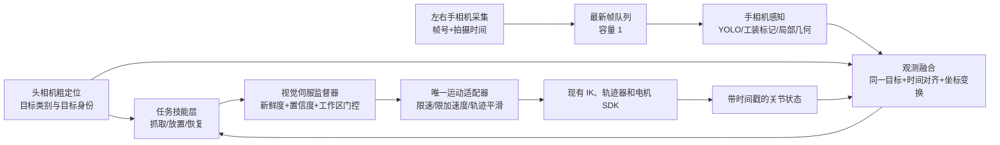

# T170 手相机视觉伺服误差修正技术方案

**版本**：讨论稿 v1.0，2026-10-19。手相机伺服尚未接入当前运行时。当前抓放以 [`AI_HANDOFF.md`](AI_HANDOFF.md) 和 [`dispatch_flow.md`](dispatch_flow.md) 为准。  
**目标场景**：T170 轮式双臂机器人在料盘、两台 CNC 传送带之间完成自动抓取、转运和放置。  
**代码依据**：本仓库 `/home/ti5robot/T170Clean`。起草时对照的提交是 `825c0e7`，文中链接已改成相对本仓库的路径。运行行为以当前源码为准。  
**方案边界**：只设计机器人的视觉、坐标估计、动作修正与验证接口；调度、无人小车、CNC 内部逻辑不在本方案内。

> **核心决策**：新建独立的手相机视觉伺服链路。旧版手相机停稳拍照逻辑只用于了解历史约束和现有接口，不作为新模块的代码基础，不要求在旧流程上打补丁。头相机继续负责粗定位和目标选择；手相机在机械臂接近时持续观测同一目标，并在安全的末端工作区内修正抓放误差。

## 1. 要解决的实际问题

当前闭环已经在单台机器人、两台机床的特定场景下取得初步结果，但大量工位偏置使迁移到第二台同型号机器人或第二个工位时需要重新调试。视觉伺服希望把“抓放点与实际目标的相对误差”变成可测量、可校正的在线量，提高重复精度并缩短固定等待时间。

这里的目标通常不主动运动，**运动的是手相机和夹爪**。因此，“实时”指机械臂接近过程中不断得到新观测，并在结果仍新鲜时更新末端运动；它不要求 YOLO 与电机指令以相同频率运行。若传送带在取放期间仍运动，必须把其速度和触发时序纳入目标预测，不能直接套用本文的静止目标模型。

成功标准应同时覆盖：

1. **准确**：实际工件相对于夹爪或放置位的误差落在工装允许的几何容差内；不能只用检测框精度或编码器正运动学代替实际抓放结果。
2. **连续**：接近、修正、下探、抓放和退出保持可控的速度/加速度，避免每次手相机拍照都停住等待固定时长。
3. **稳定**：丢帧、误检、遮挡、标定漂移、推理过慢和目标切换时有确定的拒绝与恢复行为。
4. **可复制**：同型号机器人共享算法实现；每台机器独立保存硬件和标定数据；每个工位独立保存几何配置；每种工件独立保存工艺配方。

## 2. 当前仓库的真实起点

| 现状 | 源码依据 | 对新方案的影响 |
| --- | --- | --- |
| 配置有头相机、左右 D405，但初始化只启动头相机。`use_hand_camera` 当前为 `false`。 | [`config/realsense_cameras.yaml`](../config/realsense_cameras.yaml)、[`src/realsense_get.cpp`](../src/realsense_get.cpp)、[`config/move_box_params.yaml`](../config/move_box_params.yaml) | 新链路需自己定义相机生命周期和失败隔离。不能仅切换旧开关。 |
| 旧手相机流程先等手臂停稳，再固定等待、清缓冲、取新帧、同步推理；抓取分支固定筛选毛坯类别。 | [`src/move_box_runtime.cpp`](../src/move_box_runtime.cpp) | 旧流程与连续观测目标不一致；保留原入口供回退，新链路独立实现。 |
| 视觉引擎经 pybind11 同步调用 Python `CirclePoseEngine.run()`；其内调用 Ultralytics YOLO 分割。配置的输入长边为 1280，`retina_masks=true`。 | [`src/seg_pose_bridge.cpp`](../src/seg_pose_bridge.cpp)、[`algorithm/engine.py`](../feeding_cylindrical_parts_alg/algorithm/engine.py)、[`algorithm/segmentation_yolo.py`](../feeding_cylindrical_parts_alg/algorithm/segmentation_yolo.py)、[`config/pose_params.yaml`](../feeding_cylindrical_parts_alg/config/pose_params.yaml) | 可以先复用模型权重和输出语义，但需要新的异步推理适配层。实际推理耗时尚未测量，不能用云台或其他机器的 FPS 代替。 |
| 相机帧含 RGB、对齐深度和内参，但没有采集时间戳；轨迹执行器按 5 ms 发送预生成关节位置。 | [`include/realsense_get.h`](../include/realsense_get.h)、[`src/function.cpp`](../src/function.cpp) | 先建立图像与关节状态的时间对应关系；5 ms 下发周期并不证明现有 SDK 支持在线重定向。 |
| 现有头相机用于料盘/传送带目标识别；料盘二空孔为独立任务；传送带流程在现有入口中取头相机帧。 | [`src/move_box_runtime.cpp`](../src/move_box_runtime.cpp)、[`orchestrator/cpp/robot_runtime.cpp`](../orchestrator/cpp/robot_runtime.cpp) | 新链路应支持按任务注入不同目标检测器，不能把“毛坯抓取”硬编码为所有手相机精修。 |

**未验证事项**：手相机实际视野及遮挡、三台相机同时打开后的 USB 带宽、Jetson 上当前模型的端到端延迟、运动控制接口对中途换轨迹的支持、各工位真实机械容差。这些必须现场测量，不能从静态源码推断。

## 3. 参考实现与可迁移经验

| 参考项目 | 读到的关键机制 | 对 T170 的取舍 |
| --- | --- | --- |
| [Realtime-CineFollow-Gimbal](https://github.com/SuperJack0228/Realtime-CineFollow-Gimbal)：[主程序](https://github.com/SuperJack0228/Realtime-CineFollow-Gimbal/blob/main/rpi_app/src/main.cpp)、[共享状态](https://github.com/SuperJack0228/Realtime-CineFollow-Gimbal/blob/main/rpi_app/include/utils/SharedState.h) | 相机回调只保留最新帧；YOLO、100 Hz 控制、50 Hz 串口发送分线程；控制器有死区、限速和平滑速度步进。 | 复用**感知与控制解耦、最新结果覆盖、固定周期控制**。新增观测时间戳、机器人位姿对齐和结果过期超时；双轴像素误差不能直接变成七轴电机速度。仓库中的 `TrajectoryPlanner.h` 不是主程序当前实际调用路径。 |
| [Hello Robot Stretch 视觉伺服](https://github.com/hello-robot/stretch_visual_servoing)：[抓取循环](https://github.com/hello-robot/stretch_visual_servoing/blob/main/visual_servoing_demo.py)、[YOLO/深度处理](https://github.com/hello-robot/stretch_visual_servoing/blob/main/yolo_servo_perception.py)、[速度控制](https://github.com/hello-robot/stretch_visual_servoing/blob/main/normalized_velocity_control.py) | D405 同时观测目标与夹爪指尖，用相对位置误差闭环；分割目标区域后取深度中位数；检测丢失时停止相应运动。 | 借鉴末端相对误差、局部深度统计和可见性门控。演示中的 2 cm 触发抓取阈值不能用于 T170 的机械容差。 |
| [ViSP 的 UR 图像视觉伺服示例](https://github.com/lagadic/visp/blob/master/example/servo-universal-robots/servoUniversalRobotsIBVS.cpp) | 用 AprilTag 角点构造期望与当前图像特征，逐帧计算控制律；标记丢失则输出零速度。 | 固定料盘或传送带工装若允许安装标记，可评估图像特征误差（IBVS）作精修；工件本身不必一开始求完整六维位姿。 |
| [MoveIt Servo](https://github.com/moveit/moveit2/blob/main/moveit_ros/moveit_servo/src/servo_node.cpp)、[官方教程](https://github.com/moveit/moveit2_tutorials/blob/main/doc/examples/realtime_servo/realtime_servo_tutorial.rst) | 独立处理命令超时、平滑停止、关节限制、奇异位形和碰撞。 | 借鉴控制接口与安全约束。当前 T170 不必为此立即迁移 ROS 2/MoveIt；若未来需要持续速度伺服，再评估其模型和驱动接入成本。 |
| [ROS-Industrial Calibration](https://github.com/ros-industrial/industrial_calibration)、[OpenCV `calibrateHandEye` 文档](https://docs.opencv.org/4.x/d9/d0c/group__calib3d.html) | 工业手眼标定与坐标变换的成熟实现。 | 建立每台机器人独立的手眼/TCP 标定、独立验证和版本管理。标定残差与末端实际放置误差都要记录。 |

辅助工具：[RealSense 帧时间戳与时间域 API](https://github.com/realsenseai/librealsense/blob/master/include/librealsense2/h/rs_frame.h)、[Ultralytics 视频流的丢帧/缓冲设置](https://docs.ultralytics.com/modes/predict)、[Ultralytics 模型格式与性能基准](https://docs.ultralytics.com/modes/benchmark)。这些资料用于设计和对比，实际选择以 T170 的模型、Jetson、相机和工装测试为准。引用开源实现的思想不等于可直接复制其代码；如需引入源码，另行核对许可证及依赖。

## 4. 推荐系统架构



接口应传递**完整观测**，而非只传 `x/y`：`camera_id`、`frame_id`、`capture_time`、`time_domain`、`target_id`、`task_type`、`target_pose_or_features`、`confidence`、`depth_valid_ratio`、`calibration_version`。新感知模块只提交建议目标，不直接下发电机命令；整个机械臂只允许一个运动执行者，避免旧轨迹线程与新伺服线程同时写电机。

### 4.1 目标与任务分开

- **料盘一抓毛坯**：头相机定料盘/孔位及目标，手相机跟踪同一毛坯并修正夹爪对准误差。
- **半加工出料口抓取、精加工出料口抓取**：先验证传送带在抓取窗口内是否停住；若运动，应增加速度估计和到达时刻预测。
- **半加工/精加工进料口放置**：优先观察固定工装、传送带基准或允许安装的标记；拿着工件时要测手相机是否被工件或夹爪遮挡。
- **料盘二空孔放置**：使用空孔检测器、孔位几何和已夹工件相对 TCP 的装夹关系；不能复用毛坯类别的检测出口。

四类任务共用同一套时间同步、目标关联、伺服监督和运动接口，目标检测器、允许修正轴、容差与恢复策略由任务配置提供。

### 4.2 坐标与时间的定义

规定 `T_A_B` 表示把 B 坐标系中的点变换到 A 坐标系。`s(t)` 表示完整运动状态：至少包括手臂关节和影响手相机位姿的腰部关节；若底盘在抓放期间移动，还需包含底盘相对工位的位姿。对拍摄时刻 `t_i` 的手相机目标：

```text
T_base_object(t_i) = T_base_flange(s(t_i)) · T_flange_camera · T_camera_object(t_i)
T_base_tcp_des    = T_base_object(t_i) · T_object_tcp_des
e(t_now)          = pose_error(T_base_tcp(s(t_now)), T_base_tcp_des)
```

`T_flange_camera` 是每台机器人、每侧手相机的手眼外参；`T_object_tcp_des` 是工件/空孔相对期望夹爪位姿的工艺定义。RGB 与深度对齐、像素缩放或旋转后，内参必须同步变换。手眼矩阵方向、TCP 定义和单位都要写进标定数据及自动检查，不能依赖文件名猜测。

RealSense 时间戳可能来自硬件、系统或全局时间域；**不同时间域不可直接相减**。采集模块记录设备时间域和主机单调时钟接收时刻，并校准两者映射，再从机器人状态环形缓冲插值得到 `s(t_i)`。如果无法可靠对时，新链路先限制末端速度并在低速段采图验证，不能假装时间误差不存在。若底盘运动，目标位姿应先锚定到工位坐标系，再通过当前底盘位姿转换到机械臂控制坐标系。

同一张手相机图若能同时看到目标与夹爪特征，可直接估计二者相对误差，降低部分绝对标定误差的影响；但最终夹取/放置高度与安全边界仍需要可信的深度、TCP 和工装几何。

## 5. 连续修正控制策略

### 5.1 首版：运动中观测、末端短距离修正

1. 头相机锁定目标；任务技能层生成保守的大段接近轨迹和安全的末端修正区域。
2. 接近轨迹执行时，手相机持续采集。新推理任务读取最新帧；若推理比取帧慢，丢弃旧帧，不积压。头相机选定的目标 ID、类别、几何位置与手相机候选共同约束关联，避免误跳到相邻零件或相邻孔。
3. 对每次观测做有效性门控：类别、置信度、深度有效比例、目标是否落在预期空间窗口、与上一帧跳变量、观测年龄、标定版本。
4. 到达末端修正区域时，用最新有效观测生成**有界的短轨迹**。优先修正 XY；Z 和姿态只在其感知精度与工装需要均已验证后开启。修正轨迹与接近轨迹在速度上连续衔接，具体实现取决于现有运动接口是否支持中途更新。
5. 下探/合爪或放置前再做一次门控。抓后验证夹持状态；放后验证工件离爪和目标位状态。若视觉无法验证，记录为“动作完成但视觉未确认”，不把它算成确认成功。

这版可在不依赖高频在线速度接口的前提下先验证收益。它追求去掉固定长等待、减少无谓重拍，并不是保证第一天就达到严格意义上的逐帧全程伺服。

### 5.2 升级版：滚动短时域伺服

只有在底层确认支持**安全更新运动目标**、能读取足够及时的关节状态、并能与旧轨迹执行互斥后，才进入这一阶段。控制线程按固定周期运行，视觉结果异步更新；每次只执行短时域指令，持续重估与目标的误差。可用末端笛卡尔误差经阻尼雅可比逆或现有 IK 生成关节指令，同时约束关节、速度、加速度、奇异位形和碰撞。周期内没有新视觉结果时不重复“追赶旧检测”；达到过期阈值就减速停止。

若采用 IBVS，控制对象是标记角点、孔中心/边界等图像特征的当前值与期望值之差。**期望图像位置一般不是图像中心**：它取决于手相机相对夹爪、目标高度和期望抓放姿态。初版宜优先使用可解释的三维相对位置或固定工装标记误差，不必从一开始实现任意姿态的六自由度视觉伺服。

### 5.3 平滑与稳定性

局部控制可从比例项 `v_des = K_p · e` 起步，再加死区、最大修正范围、速度和加速度限制。死区应由像素/深度噪声换算出的物理误差决定；过大则精度不足，过小则末端来回抖动。积分项可能在目标遮挡、限幅和时延存在时累积错误，首版不建议为了消除偏置直接加大积分。结构性偏差先通过手眼、TCP、工装几何和时序排查。

**重要的频率事实**：当前配置的 15 fps 相机约每 66.7 ms 才有一帧；5 ms 的关节位置下发与 10 ms 的控制计算都不能凭空增加视觉信息。如果模型处理超过帧间隔，应优先保持结果新鲜、控制连续，而不是排队推理旧图。端到端误差风险与速度、延迟相关，例如相对速度 0.1 m/s、未补偿延迟 100 ms 时，量级约为 10 mm；这是估算示例，不是 T170 实测误差。

### 5.4 精度与节拍的共同评估

将末端误差按来源拆开记录：视觉定位噪声、深度偏差、手眼/TCP 标定残差、相机与关节状态时间偏差、底盘/腰部定位误差、轨迹跟踪误差、夹持或松爪后的工件偏移。头相机粗定位误差可以由手相机末段修正吸收一部分，但前提是目标仍在手相机视野和允许修正范围内。手相机反馈也不能替代夹爪接触后的工件姿态验证。

节拍要记录 `t_capture`、`t_inference_done`、`t_observation_accepted`、`t_motion_update`、`t_grasp_or_release`，分别计算采集延迟、推理延迟、结果年龄、视觉修正耗时和整次抓放时间的中位数及 p95。若降低输入尺寸或改为 TensorRT/ONNX，提高的不只是 FPS，还要验证实际抓放误差是否变大；模型优化以**精度与端到端时间的联合结果**决定。

## 6. 安全门控与失败恢复

| 状态 | 规定行为 |
| --- | --- |
| 目标暂时被夹爪遮挡 | 在有限的时间与位移窗口内保留最后可信的目标位姿并降低修正增益；超过窗口则退出视觉修正，按安全路径退回或请求重试。 |
| 推理结果过期、相机断流、时间域不可信 | 不再使用旧结果产生新修正；运动适配器减速到安全状态。过期阈值由实测时延、速度和停止距离确定。 |
| 候选目标跳到邻孔/邻件 | 根据头相机目标、工位几何和关联门限拒绝；不使用“最大置信度”强制切换。 |
| 深度无效或反光严重 | 拒绝依赖深度的 Z 修正；按任务允许的替代路径使用固定工装基准或退出。不得用无效深度填零继续下降。 |
| 修正量超过工作包络或 IK 无解 | 拒绝轨迹；保留现有软硬件急停与碰撞保护；记录目标、坐标链和具体拒绝原因。 |
| 双臂同时工作 | 左右相机及标定独立，任务管理层统一仲裁双臂工作空间；运动命令只有一个最终出口。 |

视觉伺服解决的是在线相对误差，不会自动消除夹爪弹性、工件装夹偏心、深度反光、工装变形等问题。可以保留有物理含义的少量工艺补偿，但每项都需标明来源、单位、适用机器人/工位和验证方法，避免重新积累不可解释的偏置。

## 7. 实施与验证顺序

| 阶段 | 开发内容 | 过关证据 |
| --- | --- | --- |
| P0：基线与硬件能力确认 | 记录当前每站的总节拍、抓放误差和失败类型；测试左右 D405 同时开启后的 USB、曝光、视野、遮挡；确认底层是否支持在线改轨迹。 | 有各站的基线数据、相机配置表、SDK 能力结论。 |
| P1：独立感知服务 | 新建手相机采集、最新帧队列、时间戳、YOLO/标记检测和目标关联接口；旧流程保持不动。先比较现有 1280 模型与局部 ROI、较小输入及部署格式的速度和定位误差。 | 每帧记录采集→取图→推理→位姿的耗时分布；没有不断增长的积帧；错误目标切换可复现并被拒绝。 |
| P2：标定与影子运行 | 建立每侧手眼和 TCP 标定；手相机在现有动作过程中只计算建议修正，不控制机械臂。 | 在不同机械臂姿态、料盘行列和传送带位置，比较观测位姿与独立测量结果；有时间同步误差与外参残差。 |
| P3：末端有界修正 | 先选单臂、单工位、单工件类型做低速抓取；随后扩展放置、左右臂、两个 CNC。逐步取消固定等待，并保留一键回退到原动作入口。 | 实际抓放误差、成功率、每阶段耗时与失败恢复数据优于或不劣于基线；异常输入均触发预期门控。 |
| P4：连续伺服与复制部署 | 仅在 P3 达不到节拍/精度目标且 SDK 能力满足时加入滚动短时域控制；把工位配置、机器人标定与配方分离，复制到第二台机器人。 | 第二台机器无需修改算法代码；只通过标定、配置与统一验收流程上线。 |

正式验收阈值不能从参考仓库的演示参数照搬。先由夹爪开口、工件直径、孔/传送带导向几何和安全间隙推导允许的 XY/Z/姿态误差，再由工厂节拍要求给出允许的 p95 时间。建议连续运行足够多次、覆盖不同料盘位置、左右臂、光照、工件表面状态及恢复情形；同时报告首件成功率和长时间稳定性，避免只展示最顺利的一次演示。

## 8. 工程封装与批量部署

建议新建与旧手相机逻辑并列的模块，而不是继续向 `move_box_runtime.cpp` 塞分支：

```text
vision_servo/
  camera/          # RealSense 生命周期、帧时间戳、最新帧队列
  perception/      # 工件、空孔、工装标记检测及统一 Observation
  calibration/     # 手眼、TCP、坐标变换及校验
  association/     # 头相机目标与手相机候选的身份匹配
  control/         # 新鲜度、门控、误差计算、平滑修正
  motion_adapter/  # 与现有 IK/轨迹/电机 SDK 的唯一连接
  skills/          # 各抓取/放置任务的阶段和恢复流程
  metrics/         # 时延、误差、结果及版本记录
```

配置分四层：**共享算法版本**（代码与模型）、**机器人硬件/标定**（相机序列号、内外参、TCP）、**工位几何**（料盘、传送带、机床基准）、**工件配方**（尺寸、夹爪宽度、目标类别、允许误差和速度）。一次运行记录 Git commit、模型文件校验值、四层配置版本与标定日期。将标定结果当作可审核的测量数据，而不是直接改代码常量。

新入口建议由现有任务编排调用统一技能接口，例如“抓取料盘一毛坯”“放到半加工进料口”。任务编排不关心内部用了 YOLO、标记还是深度，也不直接计算手相机修正。旧入口保留到新链路单机验收完成，用运行配置切换；**同一次抓放任务不能混用新旧运动执行者**。

## 9. 下一次现场优先收集的数据

1. 每种抓放姿态下，手相机能否同时看见目标和夹爪/工装基准；靠近到多少距离开始遮挡。
2. 三相机同时开启时的实际帧率、丢帧、曝光与 USB 错误；左右相机序列号和安装朝向。
3. 现有 `bestlatest.pt` 在机器人上各阶段的延迟：取图、颜色/深度对齐、Python 桥接、YOLO、位姿估计，以及端到端结果年龄。
4. 拍摄时间与关节状态时间是否能对齐；底层是否允许取消、替换或连续更新正在执行的关节轨迹。
5. 工件/空孔的实际允许偏差、传送带抓放时是否停止、合爪/松爪成功的独立判据。

这些数据决定末端视觉伺服的控制带宽和具体验收值。在它们测出之前，本文给出的是**可实施的技术路线**，不是声称新算法已在机器人上验证通过。
