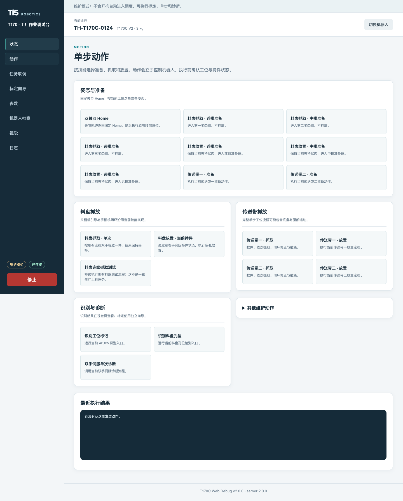
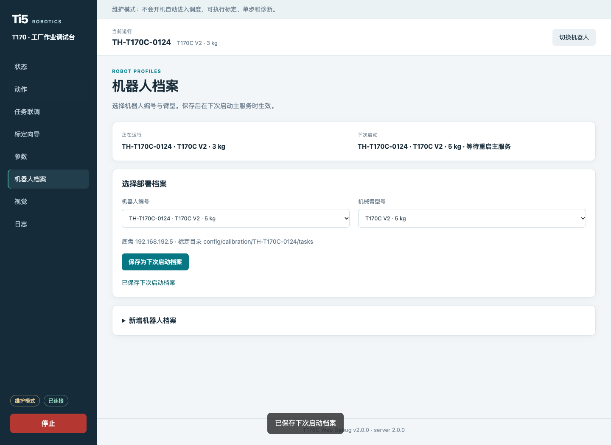

# Home 外展与调试台验证记录

基线：`3cfb6b9`，包含 11 月 19 日现场参数改动。Home 的几何对照基线为 `30cc366`，即现场只改 J2 之前的固定关节 Home。

## 模型与运动

3/5 kg 分别重新求解七轴 Home，TCP 位姿作为主约束，肘部向外比例设为 0.5。正式执行继续读取固定 Home 关节角，不运行离线求解过程。

| 模型 | 右肘向外增加 | 左肘向外增加 | TCP |
|---|---:|---:|---|
| V2 3 kg | 37.45 mm | 37.21 mm | 保持 `(0.45, ±0.35, -0.10)` m，RPY 为 0 |
| V2 5 kg | 45.21 mm | 45.21 mm | 同上 |

对照数据见 `home_reference_fk.csv`，包含两版关节角、TCP 和肘坐标。`reference_fk.py` 使用独立 MDH 连乘，不调用 SDK；3 kg 使用解析后 runtime 中的真实工具变换（含旧法兰到 V2 的小角度转换），5 kg 使用名义 260 mm 工具，与运动回归测试一致。不能把 3 kg 的工具旋转直接置零后解释为真实部署 TCP。

回归覆盖：七变量 QP 的 KKT、有效限位、MDH Jacobian、Home 末端位置与朝向、肘部外展、Home/偏好一致、左右镜像、历史失败直线与 Home 的固定关节返回。

参考模型下，历史起点返回新 Home 的名义轨迹时间为右 2.60 s、左 3.09 s；该值不包含现场执行器跟随与到位等待，也不是实机节拍。

## 构建与测试

离线构建通过，包括生产源文件编译检查。CTest 总计 41 项：39 项普通离线测试、2 项本机回环服务测试，均通过。后续图片版本和界面只读改动另行复核了标定会话、档案及 HTTP 测试。

新增/扩展覆盖：

- 基础文件完整时切换 3/5 kg、新建编号与底盘身份同步。
- 新机不继承其他机器人的手眼及抓放任务标定，缺失基础文件时不激活。
- 无效型号、路径越界、旧页面选择状态不改写部署入口。
- 标定图片跟随主服务 runtime 切换，头/手图片会话和版本检查。
- 生产模式、标定占用时拒绝网页档案写入。
- 无效显式 runtime 不再退回源码目录继续启动。
- 动作元数据与 C++ 命令目录一致，不包含退役命令。

## 浏览器交互

本机 Chrome 使用模拟 HTTP 接口验证：有效动作展示、Home 请求、维护/生产界面适配、档案保存后等待重启提示、头/手图片显示、参考点点击，以及 390 px 移动端宽度；未出现 JavaScript 页面错误。

截图使用模拟状态，**不是实机运行截图**。其中档案截图演示从 3 kg 运行状态暂存 5 kg；真实源码的 No.124 档案仍为 3 kg，未被测试修改。

## 现场复核

本地未连接 CAN、相机或机器人；Linux SDK 动态链接与实际运动未在 Mac 上验证。机器人更新后先复核 Home 外观与 TCP 朝向，再完成标定向导的检测、接近 D 点和微调。图片接口修复不能代替运动可达性验证；运动失败仍应保留 `[arm_plan]`、`[arm_ik]` 与会话日志。

启动、机器人切换与部署文件位置见 [调试台说明](../../deployment/WEB_WORKSPACE.md)。
