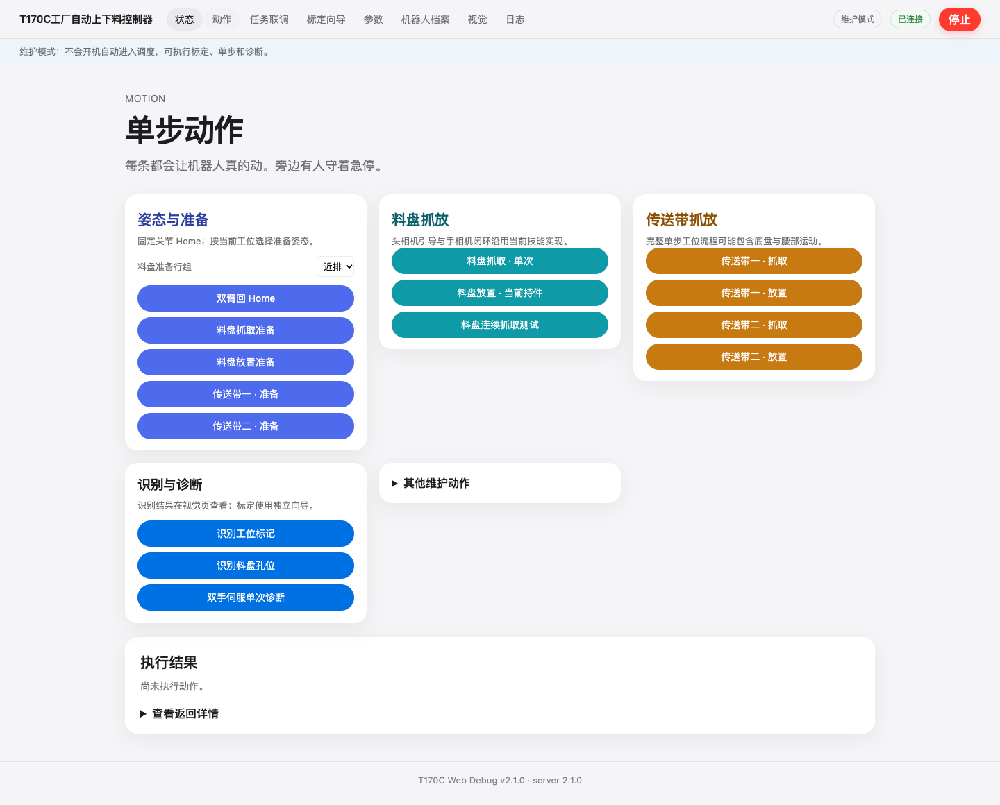
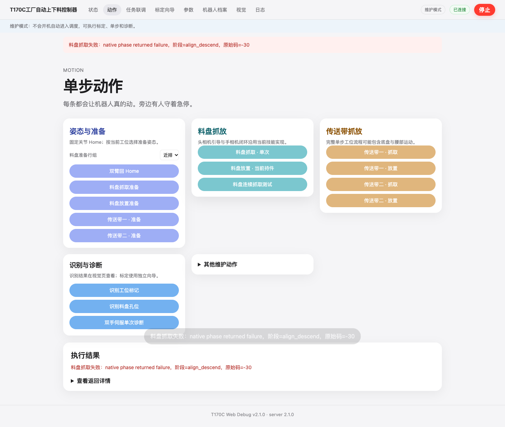

# 第一批恢复修复验证

基线：`fc310f8`（现场日志提交）。未连接真实机器人。

## 交付范围

恢复 `3cfb6b9` 的顶部导航、紧凑三列动作布局与分组配色，保留维护/生产模式适配和机器人档案切换。常用准备动作使用近/中/远排选择框；退役按钮不恢复。

修复部署后多行 YAML 矩阵读取失败，以及 `native -30 → GraspNone → code 2 → ok true` 的失败丢失链路。保留已成功侧的持件/放置信息；确定性失败终止当前任务，普通无目标和空抓沿用既有处理。

网页错误持续显示，后台任务保留错误，运行期间阻止重复动作。手动上料改用保持夹持的单次抓取入口，避免误用每轮松爪的清盘测试。放置结果使用实际放置侧字段，数值缺失显示为未知而不是零。

## 构建与自动检查

离线构建和生产源文件编译检查通过。CTest 共 44 项：41 项普通离线测试、3 项回环 HTTP/RPC 测试。

| 检查 | 验证内容 |
|---|---|
| `extrinsics_test` | 真实部署生成的左右手矩阵与头相机回退矩阵；多行、行内、平铺数组；单位与重复读取；非法输入不覆盖旧值 |
| `placement_calibration_session_test` | 向导建立会话使用真实 YAML 读取器；会话顺序和停止门控；不触碰设备 |
| `tray_skill_service_test` | 实际技能适配层保留 `-30` 与 `align_descend`，不降级为空抓重试；部分动作物理状态保留 |
| `task_result_test` | 部署文件 → C++ 读取 → 真实结果序列化；失败、拒绝、中止、无目标、部分完成、成功分别判断 |
| `web_command_result_test` | C++ 产生的失败 JSON 经过真实回环 RPC 和真实 Web 后端仍为失败；旧式假成功被拦截；失败后不执行传送带放置 |
| 既有回归 | 模型、运动、配置重载、技能、接口与部署检查 |

源码差异检查确认：`src/motion/`、`config/robot_models/`、SDK 二进制和速度/加速度/jerk 参数未变。

## 浏览器检查

本机 Chrome 访问真实 `web_debug/server.py`，其后连接模拟机器人 RPC；机器人档案操作使用临时配置副本。检查包括原布局、紧凑按钮、准备行组、`-30` 持久错误、旧式零抓取误报、部分完成、正常成功、执行期间按钮禁用、参数只读、机型暂存切换、维护/生产界面、标定图像与参考点击、390 px 窄屏。

截图使用模拟接口状态，不代表实机抓取成功。

## 实机边界

此批没有验证真实夹持效果，没有修改轨迹速度、路径平顺性或微调到位判断。现场 20–37 秒慢动作仍需第二批运动修复；标定微调误差判定仍需单独处理。四份因模型变化被忽略的旧料盘任务参考仍需在向导中确认保存，不能静默继承。

更新时重新编译主程序、重启主服务与网页后端，再刷新浏览器。操作命令见 [调试台说明](../../deployment/WEB_WORKSPACE.md)。
